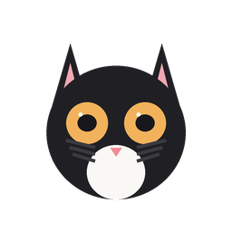
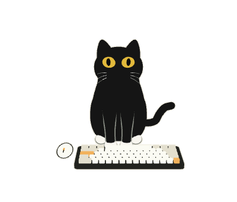
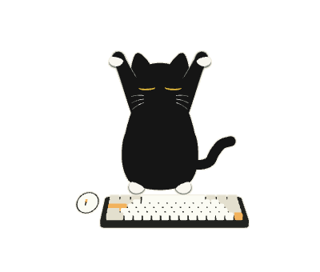
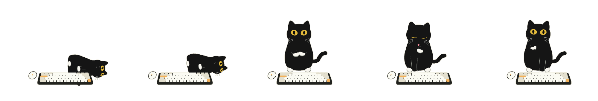

<p align="center">
  
</p>

<h1 align="center">桌面小猫 · DeskCat</h1>

<p align="center">一只住在你桌面上的 3D 小猫。<br>你敲键盘，它用爪子跟着敲；你动鼠标，它一只爪子搭在小老鼠上跟着晃。</p>

<p align="center">
  
  
  <br>
  
  
</p>

<p align="center">
  
  &nbsp;&nbsp;
  
</p>
<p align="center"><sub>站着的时候 &nbsp;·&nbsp; 伸懒腰（两只前爪一起举到耳朵两侧，身子往上拔）</sub></p>

---

## 它是什么

一个纯程序化建模的 3D 小猫，浮在桌面上，没有边框、没有任务栏图标、不抢你的输入焦点。

**没有一张精灵图、没有一个贴图。** 整只猫是 three.js 用几何体搭出来的，所有动作都是代码算出来的参数化动画——所以它能做出「按住头就闭眼蹭你」「敲得越快尾巴甩得越急」这种连续反应，而不是几张图来回切。

三个平台共用同一套 `cat.js`（猫）与 `glue.js`（胶水层），换的只是外壳：Windows 用 Tauri + WebView2，macOS 用 PyObjC + WKWebView，Linux 用 PyQt5 + QtWebEngine。

### 它会做什么

| 你干嘛 | 它怎么反应 |
| --- | --- |
| **敲键盘** | 对应的爪子按到那个键上，键帽亮起，头顶弹出你敲的字符（小键盘、符号键都支持） |
| **动鼠标** | 一只爪子搭在桌上的小鼠标上跟着晃，眼睛盯着你的光标 |
| **点鼠标** | 小老鼠被按扁、亮一下；右键它会往另一边歪，爪子跟着按下去 |
| **按住它的头** | 闭眼蹭你的手，头顶飘爱心 |
| **双击它** | 原地转一圈 |
| **拖它** | 拖到桌面任意位置，位置记进配置，下次还在那 |
| **一直不理它** | 17 种小动作自己随机来：左右张望、歪头、抖耳朵、舔爪子、伸懒腰（两只前爪举起来、身子往上拔）、打哈欠、洗脸、追自己的尾巴、挠耳朵、蹦一下、打喷嚏、探头看你、趴一会儿、就地打个滚…… |
| **敲得太猛** | 火气一点点上来：尾巴甩快 → 耳朵后压、瞳孔缩小 → 身后起红光、头顶冒火气 → 耳朵冒热汽 → 忍到头一巴掌拍在键盘上；手一慢就自己消 |
| **15 分钟没人理** | 趴下来睡着冒 `z Z z`（时间可以右键改） |

<p align="center">
  
</p>
<p align="center"><sub>你一直不理它的时候，它会自己挑一个动作做</sub></p>

> 洗脸、舔爪、挠耳朵、打滚、趴下这几个动作，小猫是**先把身子矮下去再做**的，不是站着比划——每个动作都有自己的蹲伏深度，这只猫有「重心」。

---

## 下载

到 [**Releases**](../../releases) 里下对应平台的包：

| 平台 | 文件 | 说明 |
| --- | --- | --- |
| Windows 10 / 11 (x64) | `桌面小猫.exe` | 3.5 MB 单文件，双击就跑，不用安装 |
| macOS 11+ | `桌面小猫-mac.zip` | 解压后拖进「应用程序」，再双击包里的 `首次打开.command` |
| UOS / deepin / Linux | `桌面小猫_all.deb` | `sudo dpkg -i` 装完，启动器里搜「桌面小猫」 |

各平台的详细说明（含打不开怎么办）在同一目录下的 `使用说明.txt` 里。

---

## 从源码跑起来

### Windows

需要 [Rust](https://rustup.rs/) 1.77+（MSVC 工具链）、Node.js 18+、以及系统自带的 WebView2。

```bash
cd windows
npm install
npm run build          # 产物在 src-tauri/target/release/deskcat.exe
```

### Linux / UOS

```bash
cd linux
sh install.sh          # 会检查并安装 python3-pyqt5.qtwebengine / python3-xlib
deskcat                # 启动
```

打 deb 包：`python3 make_deb.py`。

### macOS

```bash
cd macos
python3 make_app.py    # 生成 桌面小猫.app、zip 和 tar.gz
```

首次运行会自动建一个独立的 venv 并装 pyobjc（约一分钟，需要联网），之后秒开。

> macOS 上要抓全局键盘，必须在「系统设置 → 隐私与安全性 → 辅助功能」里勾上小猫，
> 否则只有鼠标跟随、敲键盘没反应。

---

## 它是怎么实现的

### 猫：一套代码跑三个平台

`web/src/cat.js` 是整个项目的核心，三个平台共用同一份。

- **几何**：头、身子、四条腿、尾巴、耳朵、瞳孔、眼皮、胡须、桌上的小键盘和小老鼠，全部用 `BoxGeometry` / `SphereGeometry` / `CylinderGeometry` 拼。没有外部模型文件，没有贴图。
- **姿势**：每个动作在 `STANCE` 表里有一条「蹲伏深度」，用一个缓动过的 `S.low` 喂给躯干宽度、躯干高度和头部高度。伸懒腰用的是**负数**——比站着还高，所以是往上拔，不是往下蹲。
- **爪子**：每只爪子有一个目标点，用临界阻尼式的缓动去追，`mode` 决定它抓的是键盘、小老鼠、自己的脸，还是举到耳朵旁边。
- **发火**：不数「按了多少下」，而是算最近 2.4 秒的**敲击速率**。7 键/秒以内完全不涨；超过才按超出的量累积。剪枝每一帧都做——停手之后速率会自然掉下来，火气跟着退。
- **表情**：眼皮开合、瞳孔大小、耳朵角度、胡须抖动都是独立通道，可以叠。

入口只有一个函数：`createCat(host, options)`，`host` 是一个 DOM 容器，猫会往里塞一个 canvas。它不依赖任何外壳，只要页面里有 `#stage` 就够了。

### 三个外壳

| | Windows | macOS | Linux |
| --- | --- | --- | --- |
| 窗口 | Tauri 2 + WebView2 | PyObjC + WKWebView | PyQt5 + QtWebEngine |
| 全局键盘 | `SetWindowsHookExW(WH_KEYBOARD_LL)` | `CGEventTap`（ListenOnly，只旁听） | X11 `XRecord` 扩展 |
| 鼠标按键 | `GetAsyncKeyState` 轮询 | `CGEventTap` 同一条流 | `XRecord` 同一条流 |
| 光标位置 | `GetCursorPos`，30 Hz | `NSEvent.mouseLocation()`，30 Hz | `QCursor.pos()`，30 Hz |
| 鼠标穿透 | 命中测试 + `WS_EX_NOACTIVATE` | `ignoresMouseEvents` 区域 | 把窗口的 X11 **input shape 置空** |

三个外壳都干同一件事：把「按键 / 光标 / 窗口位置」打包成消息，转发给页面里的 `cat.setInput(...)`。

---

## 目录结构

```
deskcat/
├── windows/                  Windows 端（Tauri 2 + Rust）
│   ├── src-tauri/src/main.rs   键盘钩子、全局轮询、右键菜单、托盘
│   └── web/                    猫本体 + 前端胶水层（三平台共用）
├── linux/                    UOS / Linux 端（PyQt5）
├── macos/                    macOS 端（PyObjC）
└── docs/img/                 图标与动作截图
```

`windows/web`、`linux/web`、`macos/web` 里的 `src/cat.js` 是**同一份文件的副本**（三个外壳的加载路径不一样，没做打包器）。改动作的时候三份要一起改。

---

## 常见问题

**杀毒软件报「键盘记录」？**
它确实要读你的按键——不然猫没法跟着你敲键盘。所有事件只在本机内存里处理，不联网、不上传、不落盘。不放心可以断网运行，功能完全正常。

**Windows 双击没反应 / 窗口一片空白**
装一下微软官方的 [Microsoft Edge WebView2 Runtime](https://developer.microsoft.com/microsoft-edge/webview2/)（Win11 和大部分 Win10 已经自带）。

**Windows 第一次运行弹「已保护你的电脑」**
点「更多信息」→「仍要运行」。这个 exe 没有买代码签名证书，不是病毒。

**macOS 说「无法验证开发者」**
双击包里的 `首次打开.command`，它会清掉下载标记并做一次本地临时签名。或者自己敲三行：

```bash
xattr -cr /Applications/桌面小猫.app
codesign --force --deep --sign - /Applications/桌面小猫.app
open /Applications/桌面小猫.app
```

**Linux 上敲键盘没反应**
本项目用的是 X11 的 `XRecord` 扩展。Wayland 会话下抓不到原生 Wayland 窗口的按键（UOS 默认是 X11 会话，一般没这问题）。可以登出后在登录界面切回「X11 会话」。

**设置存在哪**
Windows：`%APPDATA%\com.deskcat.app\config.json` · macOS：`~/Library/Application Support/DeskCat/` · Linux：`~/.config/deskcat/`。删掉就恢复默认。

---

## 许可

**免费开源，切勿商用买卖。**

你可以随意使用、修改、分发（包括在公司内部用），但**不得出售**本软件或其修改版，不得去掉署名，不得改用其他许可。完整条款见 [LICENSE](LICENSE)。

> 严格说，带「禁止商用」的许可不属于 OSI 定义的开源许可，准确叫法是「源码公开的非商业许可」。
